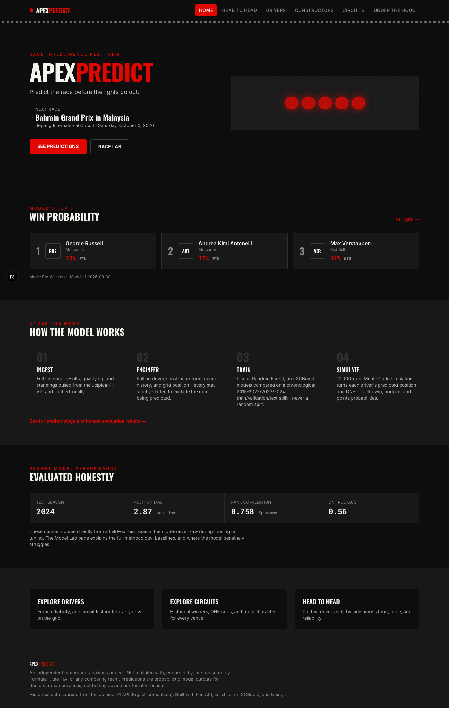
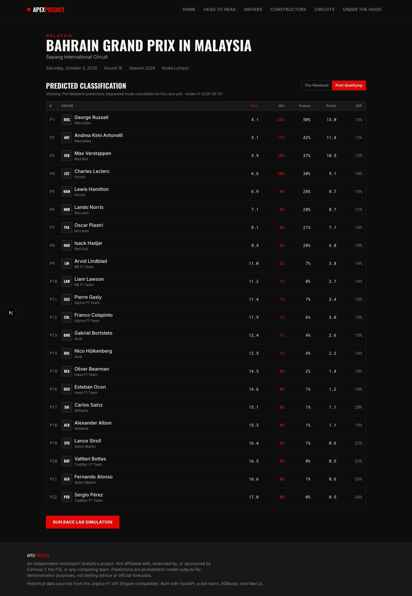
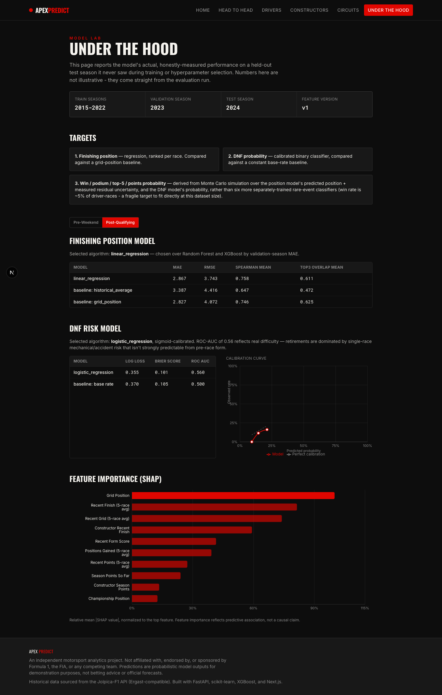
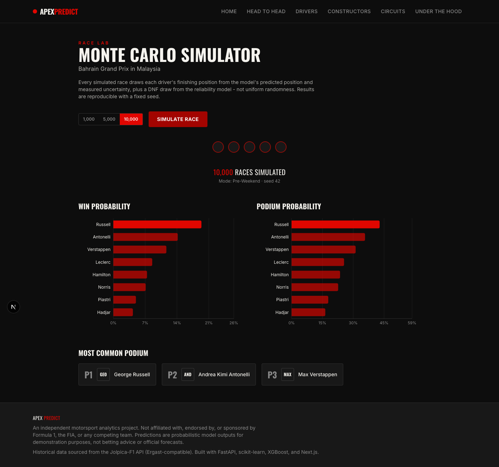
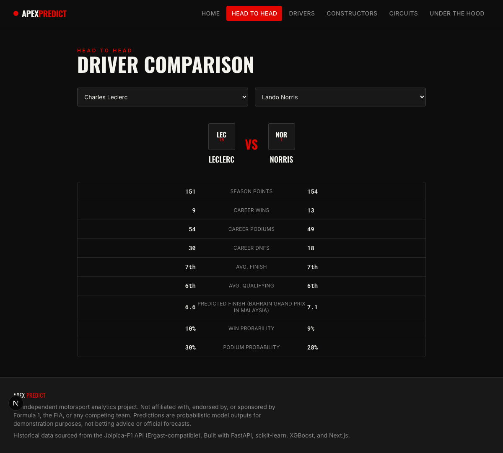
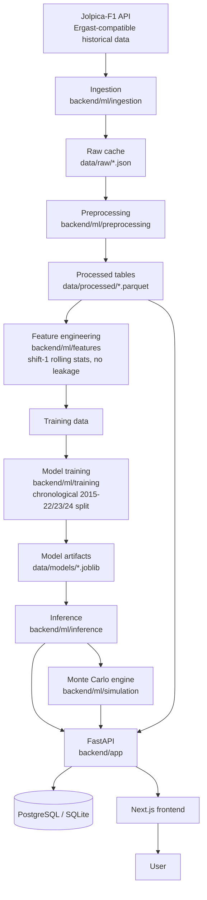

# APEX PREDICT

**Predict the race before the lights go out.**

An end-to-end Formula 1 race intelligence platform: leakage-safe ML models
trained on 2015-2026 historical data, calibrated probabilistic predictions,
a Monte Carlo race simulator, a FastAPI backend, and a Next.js frontend with
an original motorsport-inspired visual identity.

Not affiliated with, endorsed by, or sponsored by Formula 1, the FIA, or any
team. All branding is original. Predictions are model outputs for
demonstration purposes, not betting advice or official forecasts.

**Live demo:** _not yet deployed — see [DEPLOYMENT.md](DEPLOYMENT.md)._

| | | |
|---|---|---|
|  |  |  |
|  |  | |

## Overview

Given an upcoming or historical Grand Prix, Apex Predict produces, for every
driver: predicted finishing position, win/podium/top-5/points probability,
DNF probability, expected championship points, a confidence label, and a
plain-language explanation grounded in the actual features the model used.
A Monte Carlo simulator (the "Race Lab") runs thousands of simulated races
to turn those predictions into a full probability distribution over race
outcomes, including the most likely exact podium.

Every prediction is traceable to the model version that produced it. Every
number reported on the "Under the Hood" (Model Lab) page is the actual,
honestly-measured performance of the model on a test season it never saw
during training or tuning — including the parts that aren't flattering (see
[Honest results](#honest-results) below).

## Features

- **Race predictions** — full timing-tower classification for any race,
  sortable by predicted position, win/podium probability, expected points,
  or DNF risk. Pre-weekend and post-qualifying modes, so you can see how
  much qualifying actually changed the model's view of the race.
- **Race Lab** — a 1,000/5,000/10,000-run Monte Carlo simulator driven
  directly by the trained models' own predicted positions and DNF
  probabilities (not uniform randomness), with a reproducible seed.
- **Head to Head** — compare any two drivers' career stats and (for the
  upcoming race) live predicted finish/win/podium probability.
- **Driver, constructor, and circuit pages** — recent-form trend charts,
  reliability, and full historical results, generated from the same
  underlying database the predictions come from.
- **Model Lab ("Under the Hood")** — the full methodology: training/
  validation/test seasons, algorithms compared, baselines, metrics, a DNF
  calibration curve, and SHAP feature importance.
- **Explanations** — every prediction ships with 0-3 positive and 0-3 risk
  factors, computed from that driver's actual feature values relative to
  the rest of the field in that race (not templated or fabricated text).

## Architecture



Reference/historical data (races, drivers, constructors, results,
qualifying) is seeded into the relational database and served through
ordinary CRUD-style endpoints. The ML pipeline reads the same underlying
data from its parquet feature store directly, since that's its natural
pipeline artifact — there's no value in reconstructing DataFrames from ORM
rows just to feed them back into scikit-learn. Generated predictions and
simulation runs are written back into the database with full model-version
lineage, so every prediction is auditable.

## Machine learning methodology

### The leakage rule

For predicting race N, only information available **before** race N started
may be used. Every rolling/expanding/cumulative statistic in
`backend/ml/features/build_features.py` is `.shift(1)`-ed before the window
aggregation runs, so a race's own result never contributes to its own
feature row. This is directly tested in
`backend/tests/test_no_leakage.py` — including a test that mutates a race's
own outcome and asserts that race's own feature row is byte-for-byte
unchanged (only later races' rolling windows may move).

Two prediction modes reflect exactly what's knowable at that point in a
race weekend:

- **pre_weekend** — driver/constructor rolling form, circuit history,
  championship standing. No grid or qualifying information.
- **post_qualifying** — everything above, plus the actual grid position and
  qualifying gap to pole.

### Chronological train/validation/test split

Race data is a time series. It is never randomly split.

| Split | Seasons |
|---|---|
| Train | 2015-2022 |
| Validation (hyperparameter selection) | 2023 |
| Test (reported once, final) | 2024 |

2025 and the partial 2026 season are held out entirely from training/
tuning/testing; they exist only for live predictions and future backtesting.
The **production** model artifacts served by the API are the same
architecture/hyperparameters validated above, refit on all available
history through the most recently completed race — a standard practice
(evaluate honestly on a frozen holdout, then refit the validated recipe on
everything before shipping), kept clearly separate from the evaluation
artifacts so the two are never confused.

### Models compared

| Target | Baselines | Candidates | Selected (by validation score) |
|---|---|---|---|
| Finishing position (regression) | historical average, grid position | Linear Regression, Random Forest, XGBoost | Linear Regression |
| DNF probability (classification) | constant base rate | Logistic Regression, Random Forest, XGBoost | Logistic Regression (sigmoid-calibrated) |

Win/podium/top-5/points probabilities are **not** separately trained
classifiers. They're derived from Monte Carlo simulation over the position
model's predicted position (plus its measured residual uncertainty) and the
DNF model's probability. At this dataset size (~3,500 training rows), a
directly-fit "win" classifier would be modeling a ~5%-positive-rate target —
fragile and hard to calibrate well. Simulating from a well-validated
regression + reliability model is more robust and gives a coherent
distribution over the whole race, not six independent point estimates.
LightGBM and deep learning were deliberately not added: XGBoost already
demonstrates the tree-ensemble comparison, and neither showed any
evidence-based edge over the simpler models actually selected below.

### Honest results

From `data/models/model_registry.json` — the actual output of the last
training run, not illustrative numbers. Full detail (including the two
non-flattering findings below) is in
[`docs/IMPLEMENTATION_PLAN.md`](docs/IMPLEMENTATION_PLAN.md) and on the
live Model Lab page.

| Mode | Position model | Test MAE | Test Spearman |
|---|---|---|---|
| pre_weekend | Linear Regression | 3.31 | 0.654 |
| post_qualifying | Linear Regression | 2.87 | 0.758 |

| Mode | DNF model | Test LogLoss | Test ROC-AUC |
|---|---|---|---|
| pre_weekend | Logistic Regression | 0.357 | 0.526 |
| post_qualifying | Logistic Regression | 0.355 | 0.560 |

Two things worth stating plainly: **linear models beat both tree ensembles**
at this dataset size on both targets (reported instead of forcing a
fancier-sounding model that measurably underperforms), and in
post-qualifying mode the engineered model **ties the grid-position baseline
on raw MAE** (2.87 vs 2.83) — grid position alone is an extremely strong
predictor in F1. The model's real value-add is the probabilistic,
multi-output surface a single baseline number can't produce, plus a modest
rank-correlation improvement (0.758 vs 0.746).

## Data pipeline

```
Jolpica-F1 API → ingestion (cached JSON) → preprocessing (parquet) →
feature engineering (parquet) → training → model artifacts →
FastAPI + PostgreSQL/SQLite → Next.js
```

Every stage is a small, focused module or script under `backend/ml/` and
`backend/scripts/` — see [Project structure](#project-structure). The whole
pipeline runs end to end with one command:

```bash
cd backend && ./scripts/run_pipeline.sh   # ingest -> process -> features -> train -> seed
```

### Data source

**[Jolpica-F1](https://api.jolpi.ca/ergast/f1)**, a free, actively
maintained, Ergast-compatible REST API covering F1 seasons 1950-present. No
API key required. Every response is cached to `data/raw/`, so the app keeps
working from cache if the live API is temporarily unreachable, and reruns
never re-fetch data they already have.

Two real bugs were found and fixed in the ingestion layer while validating
against this API (see `backend/ml/ingestion/jolpica_client.py` and
`backend/ml/preprocessing/parse_raw.py` for details): the results/qualifying
endpoints paginate by *row*, not by race, which silently split a race's
classified drivers across two pages; and Jolpica's newer `"Lapped"` status
label (used from the 2023 season on) is a classified finish, not a DNF,
which was initially inflating the apparent DNF rate to ~25% before the fix
(the corrected, realistic rate is ~17%, declining over the dataset as cars
got more reliable — matching real-world F1 trends).

FastF1 (practice/telemetry) was considered but not integrated — it requires
large per-session downloads and isn't necessary for the pre-race/post-
qualifying targets this project predicts. See
[Future work](#limitations-and-future-work).

## Tech stack

**Frontend** — Next.js 16 (App Router) · TypeScript · Tailwind CSS v4 ·
Framer Motion · Recharts · TanStack Query

**Backend** — Python 3.11 · FastAPI · Pydantic v2 · SQLAlchemy 2.0 · Alembic

**Machine learning** — pandas · NumPy · scikit-learn · XGBoost · SHAP ·
joblib

**Database** — PostgreSQL (production/Docker) or SQLite (zero-setup local
dev) — same SQLAlchemy models either way

**Infra** — Docker · Docker Compose · GitHub Actions

## Local setup

Requires Python 3.11+ and Node 20+.

```bash
# Backend
cd backend
python3.11 -m venv .venv && source .venv/bin/activate
pip install -r requirements-dev.txt
./scripts/run_pipeline.sh          # ingest, build features, train, migrate, seed (~1 min)
uvicorn app.main:app --reload      # http://localhost:8000

# Frontend (separate terminal)
cd frontend
npm install
echo "NEXT_PUBLIC_API_BASE_URL=http://localhost:8000" > .env.local
npm run dev                        # http://localhost:3000
```

Copy `.env.example` to `.env` in `backend/` if you want to override any
default (database URL, CORS origins, simulation seed, etc.) — see that file
for every variable and what it does.

## Docker

```bash
docker compose up --build
```

Starts PostgreSQL, the backend (which runs the full data/ML pipeline once
on first boot if no trained models are found — subsequent restarts skip
straight to migrate+seed, since the pipeline's output is persisted in the
`./data` bind mount), and the frontend. Frontend at `http://localhost:3000`,
API at `http://localhost:8000`.

> **Note:** the Docker configuration was written and reviewed carefully
> (correct multi-stage builds, healthchecks, a Postgres-first schema) but
> not verified with a live `docker compose up` in the environment this
> project was built in (no Docker daemon available there). Please verify on
> your machine and open an issue if anything doesn't come up cleanly.

## Deployment

See [DEPLOYMENT.md](DEPLOYMENT.md) for the recommended Vercel (frontend) +
Render (backend) + Neon/Supabase (Postgres) setup, environment variables,
and migration steps.

## API

Interactive docs at `/docs` (Swagger) and `/redoc` once the backend is
running. Key endpoints:

| Endpoint | Description |
|---|---|
| `GET /health` | Liveness check |
| `GET /api/races` · `/api/races/upcoming` · `/api/races/{race_id}` | Race schedule and detail |
| `GET /api/predictions/{race_id}?mode=pre_weekend\|post_qualifying` | Full predicted classification |
| `POST /api/simulate/{race_id}` | Monte Carlo simulation (`n_simulations`, `seed`, `prediction_mode`) |
| `GET /api/drivers` · `/api/drivers/{id}` · `/api/drivers/{id}/results` | Driver directory, profile, recent results |
| `GET /api/constructors` · `/api/constructors/{id}` | Constructor directory and profile |
| `GET /api/circuits` · `/api/circuits/{id}` | Circuit directory and historical winners |
| `GET /api/model/metrics` | Full Model Lab data: metrics, baselines, calibration, SHAP importance |

`race_id` is `{season}-{circuit_id}`, e.g. `2024-monza`.

## Testing

```bash
# Backend: 35 tests — leakage, simulation, explanations, database, model
# inference, and API endpoints (the last two skip gracefully if the data
# pipeline/trained models aren't present yet)
cd backend && pytest tests/ -v

# Frontend: typecheck, lint, production build
cd frontend && npx tsc --noEmit && npm run lint && npm run build

# Frontend: Playwright E2E (needs both servers running with seeded data)
cd frontend && npm run test:e2e
```

The leakage tests in `tests/test_no_leakage.py` are the ones that matter
most for this project's central claim — they're pinned, not aspirational.

## Project structure

```
apex-predict/
├── backend/
│   ├── app/            # FastAPI: api/, core/, db/, models/, schemas/, services/
│   ├── ml/             # ingestion/, preprocessing/, features/, training/,
│   │                    evaluation/, inference/, simulation/
│   ├── scripts/        # pipeline entrypoints (ingest, build, train, seed)
│   ├── alembic/        # DB migrations
│   └── tests/
├── frontend/
│   ├── app/             # Next.js App Router pages
│   ├── components/      # layout/, ui/, home/, race/, charts/
│   ├── lib/, hooks/      # typed API client, formatting, React Query hooks
│   └── e2e/              # Playwright smoke tests
├── data/
│   ├── raw/              # cached API responses (gitignored)
│   ├── processed/        # cleaned parquet tables (gitignored)
│   ├── models/           # trained artifacts + metrics (gitignored)
│   └── sample/            # small committed 2024-season CSV sample
├── docs/                  # implementation plan, screenshots
├── notebooks/             # (empty by design - see notebooks/README.md)
└── .github/workflows/     # CI
```

## Limitations and future work

**Limitations**, stated plainly rather than glossed over:

- DNF prediction is only weakly better than a constant base rate
  (ROC-AUC 0.53-0.56) — motorsport retirements are dominated by single-race
  incidents that aren't strongly predictable from pre-race form.
- The post-qualifying position model ties the grid-position baseline on raw
  MAE; its edge is in rank correlation and the probabilistic outputs, not a
  dramatically lower error.
- Circuit type (street/permanent/high-speed) is a small hand-maintained
  lookup, not sourced data.
- The assumed race-day lineup for a future race is "whoever raced most
  recently" — mid-season driver swaps won't be reflected until they appear
  in results.
- No live weather data; the "what-if" weather scenario described in the
  original spec was not built (see below).

**Future work:**

- FastF1 integration for practice-session pace and real weather data.
- A "What-If" scenario tool (grid position / weather / DNF-risk sliders).
- Championship-simulation (remaining-season Monte Carlo) and a "Beat the
  Model" client-side prediction game.
- SHAP waterfall charts per-driver (currently: global importance + a
  rule-based per-driver explanation layer).
- Track-map visualization from circuit coordinate data.
