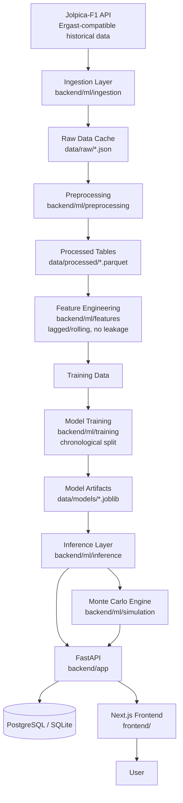

# APEX PREDICT — Implementation Plan

"Predict the race before the lights go out."

This document is the working plan for building Apex Predict, an end-to-end
Formula 1 race intelligence platform: leakage-safe ML predictions, Monte Carlo
simulation, a FastAPI backend, and a Next.js frontend. It is updated as phases
complete.

## Architecture

## Data source decision

**Primary: Jolpica-F1** (`https://api.jolpi.ca/ergast/f1`), a free, actively
maintained, Ergast-compatible REST API covering seasons 1950–present (results,
qualifying, standings, circuits, drivers, constructors). Verified reachable
2026-09-30. No API key required. Responses are cached to `data/raw/` as JSON
so the app degrades gracefully (cached/demo mode) if the API is unreachable.

**Deferred: FastF1** (practice-session pace, telemetry, weather). Noted as
future work (see README "Future Work") — it requires large per-session
downloads and is not necessary for the core pre-race/post-qualifying
prediction targets. The ingestion layer is written with a pluggable
`SourceClient` interface so it can be added later without touching downstream
code.

## Scope decisions (engineering judgment applied per user's "make sensible
decisions yourself" instruction)

- **DB**: SQLAlchemy models written Postgres-first (JSON columns avoided,
  proper types/indexes), but local dev + CI run on SQLite for zero-setup.
  `DATABASE_URL` env var switches between them.
- **Models**: scikit-learn baselines (grid-position baseline, logistic/linear
  regression) compared against RandomForest and XGBoost. LightGBM is skipped
  as a redundant third tree library — XGBoost already demonstrates the
  tree-model comparison at this dataset size (~5-6k driver-race rows) without
  doubling maintenance surface. Deep learning is not used: tabular data this
  size gives it no evidence-based edge over calibrated tree models. Both
  trade-offs are stated explicitly on the Model Lab page, not hidden.
- **Ranking**: expected-finish regression + rank-by-score, compared against
  grid-order baseline using Spearman/Kendall/MAE/top-3 accuracy.
- **Simulation**: Monte Carlo draws per-driver finishing-position samples from
  a model-derived distribution (predicted position + residual-based spread +
  DNF draw), resolved into a valid permutation per simulated race.
- **Docker**: written and documented; not runnable in this dev environment
  (no local Docker daemon) — validated via config review + backend/frontend
  native runs instead. Flagged clearly in DEPLOYMENT.md for user verification.

## Phases (tracking against the 20-phase spec)

- [x] Phase 1 — Inspect repo/environment
- [x] Phase 2 — Architecture & project structure
- [ ] Phase 3 — Historical data ingestion (Jolpica client + cache + raw pull)
- [ ] Phase 4 — EDA / data quality validation
- [ ] Phase 5 — Leakage-safe feature engineering
- [ ] Phase 6 — Baseline models
- [ ] Phase 7 — Stronger models (RF, XGBoost) + tuning
- [ ] Phase 8 — Final model selection with evidence
- [ ] Phase 9 — Monte Carlo simulation engine
- [ ] Phase 10 — FastAPI backend
- [ ] Phase 11 — Database + migrations
- [ ] Phase 12 — Frontend design system
- [ ] Phase 13 — Main frontend pages
- [ ] Phase 14 — Frontend <-> backend integration
- [ ] Phase 15 — Explainability (SHAP / rule-based factors)
- [ ] Phase 16 — Testing (backend leakage/API/sim tests, frontend smoke)
- [ ] Phase 17 — Docker
- [ ] Phase 18 — CI/CD (GitHub Actions)
- [ ] Phase 19 — Deployment prep (Vercel/Render/Neon docs)
- [ ] Phase 20 — Final audit

Progress is committed to git after each phase with a descriptive commit
message so the history itself documents the build.
